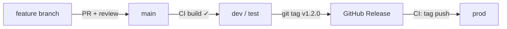

# Module 7 — CI/CD with GitHub Actions

Manual pushes are fine for dev, but teams deploy with pipelines. This module turns "merge to main → app updated" into an automated flow.

## 1. Why CI/CD for a Code App?

- Every PR gets a **build check** — broken code never reaches `main`
- Deploys to test/prod are **repeatable and auditable** — no "works on my machine"
- Environment access moves from personal accounts to a **service principal** — people can leave the team without breaking the pipeline

## 2. The build-validation workflow (included in this repo)

`.github/workflows/build-validation.yml` runs on every push and pull request:

```yaml
name: Build validation
on:
  push:
    branches: [main]
  pull_request:

jobs:
  build:
    runs-on: ubuntu-latest
    steps:
      - uses: actions/checkout@v4
      - uses: actions/setup-node@v4
        with:
          node-version: 20
          cache: npm
      - run: npm ci
      - run: npm run build
```

Once this passes, enable it as a **required status check** on `main` (module 5, step 3).

## 3. Deploy to an environment with a service principal

### One-time setup (admin)

1. Register an Entra ID **app registration** and create a client secret
2. Create an **application user** in the target environment's Dataverse with the right security role
3. Add the secrets to GitHub: **Settings → Secrets and variables → Actions**:
   - `POWERPLATFORM_TENANT_ID`
   - `POWERPLATFORM_CLIENT_ID`
   - `POWERPLATFORM_CLIENT_SECRET`

### Deploy job (sketch)

```yaml
  deploy-test:
    needs: build
    if: github.ref == 'refs/heads/main'
    runs-on: ubuntu-latest
    steps:
      - uses: actions/checkout@v4
      - uses: actions/setup-node@v4
        with: { node-version: 20, cache: npm }
      - run: npm ci && npm run build
      - name: Install PAC CLI
        run: dotnet tool install --global Microsoft.PowerApps.CLI.Tool
      - name: Authenticate
        run: |
          pac auth create \
            --applicationId ${{ secrets.POWERPLATFORM_CLIENT_ID }} \
            --clientSecret ${{ secrets.POWERPLATFORM_CLIENT_SECRET }} \
            --tenant ${{ secrets.POWERPLATFORM_TENANT_ID }}
      - name: Push code app to test
        run: pac code push --environment ${{ secrets.TEST_ENV_URL }}
```

> 📌 The `pac code push` parameters may vary slightly by CLI version — check `pac code push --help` and Microsoft's Power Platform build tools docs before running in anger.

## 4. Release-gated deploys to prod

Combine with versioning (module 6): only deploy to prod when a **tagged release** is created:

```yaml
on:
  push:
    tags: ['v*.*.*']
```

Full flow at a glance:



## 5. Guardrails worth agreeing on as a team

- `main` is protected: PR + approval + passing build, always
- Service principal secrets live **only** in GitHub Secrets — never in code
- Deploys to prod only from tagged releases
- One environment per stage (dev → test → prod), each with Code Apps enabled

✅ **Checkpoint:** merging a PR to `main` produces a green build without anyone touching a terminal.
